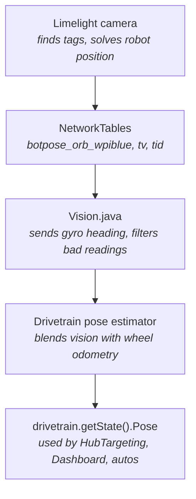

# Vision and Field Positioning

How the robot uses the Limelight and AprilTags to know where it is on the field, and how that position drives hub aiming and the dashboard.

Read this before reviewing or changing `Vision.java`, `HubTargeting.java`, or anything in `Constants.Vision` / `Constants.Aim`.

## The short version

The camera never "finds the robot". It finds **AprilTags**, which sit at known, fixed spots on the field. Because the robot knows exactly where each tag is, and the camera can measure exactly how that tag looks from where it is, the robot can work backwards to where it must be standing.



## Files involved

| File | Role |
|---|---|
| `subsystems/Vision.java` | Sends the gyro heading to the Limelight, reads its pose estimate, rejects bad readings, feeds good ones to the drivetrain |
| `LimelightHelpers.java` | Limelight's official helper library. Reads and writes the Limelight's NetworkTables entries. Not ours; don't edit |
| `subsystems/CommandSwerveDrivetrain.java` | Owns the pose estimator (CTRE `SwerveDrivetrain`). `addVisionMeasurement` converts the Limelight's timestamp to CTRE's clock |
| `HubTargeting.java` | Uses the robot pose and the 2026 field map to compute hub distance, aim angle, "lined up" and "in scoring zone" |
| `Dashboard.java` | Publishes the vision and aim values to Elastic (`Vision/…` and `Aim/…` topics) |
| `sim/LimelightSim.java` | **Simulator only.** Fakes the Limelight by writing the same NetworkTables entries a real one would |
| `Constants.java` | `Vision` (camera mount, trust, filters) and `Aim` (tolerance, shooter side, heading gains) |

## Step 1: Detecting tags (on the Limelight)

All image processing runs **on the Limelight's own processor**, not the roboRIO. Robot code never sees the image, only the results.

For each camera frame, the Limelight:

1. **Looks for dark quadrilaterals**: candidate shapes with a thick black border.
2. **Decodes the inner pattern.** The grid of black and white cells encodes the tag **ID** (1–32 on the 2026 field). The code family (36h11) is designed so one tag can't be misread as another.
3. **Locates the four corners** to sub-pixel precision. Everything else is computed from those four points.

## Step 2: From four corners to a relative position

The Limelight knows:

- the **real size** of the tag (the black square is 6.5 in on the 2026 field), and
- its **lens calibration** (focal length and distortion, set at the factory).

A square of known size looks smaller when it's farther away and skewed when it's seen at an angle. From the four corners, the Limelight solves for the **camera's position and rotation relative to the tag**: distance, left/right offset, height, and angle. (This is the "Perspective-n-Point" problem.)

## Step 3: The field map: relating tags to field position

The Limelight has a **field map** uploaded (set in its web UI at `http://limelight.local:5801`). It lists every tag's ID with its exact 3D position and facing direction on the field. That lets it chain three transforms:

```
tag's pose on the field              (from the field map)
  → camera's pose relative to tag    (from Step 2)
  → robot center relative to camera  (from the camera mount, see below)
  = robot's pose on the field
```

### The camera mount (robot code supplies this)

At startup, `Vision`'s constructor sends the camera's mounting position to the Limelight:

```java
LimelightHelpers.setCameraPose_RobotSpace(name,
        Constants.Vision.kCamForwardMeters,   // + toward the front
        Constants.Vision.kCamSideMeters,      // + toward the left
        Constants.Vision.kCamUpMeters,        // height above the floor
        Constants.Vision.kCamRollDeg,
        Constants.Vision.kCamPitchDeg,        // + tilted up
        Constants.Vision.kCamYawDeg);         // + turned left
```

All values are measured from the **center of the robot on the floor**. This overrides whatever is typed into the Limelight web UI, so the code is the single source of truth.

> ⚠️ **These values are still placeholders** (`TODO: measure these on the real robot`). A wrong mount offset shifts every position estimate by roughly the same error. Measure them before trusting any distance or aim readout.

### The robot code's own copy of the field map

The robot code also loads the official layout from WPILib:

```java
AprilTagFieldLayout.loadField(AprilTagFields.k2026RebuiltWelded)
```

It is **not** used for normal vision; the Limelight uses its own uploaded map. It is used by:

- **`HubTargeting`**: to compute the hub centers and scoring-zone boundaries from real tag positions instead of hand-typed numbers.
- **`LimelightSim`**: to decide which tags the fake camera could see from the simulated robot's position.

WPILib also ships `k2026RebuiltAndymark` for fields built from AndyMark parts. Tag positions differ slightly. If an event uses an AndyMark field, both this layout **and** the map on the Limelight must be switched.

## Step 4: MegaTag2 (using the gyro)

The code uses Limelight's **MegaTag2** mode. Every loop, before asking for a pose, `Vision.periodic()` sends the robot's heading:

```java
LimelightHelpers.SetRobotOrientation(name, yawDeg, yawRateDegPerSec, 0, 0, 0, 0);
PoseEstimate estimate = LimelightHelpers.getBotPoseEstimate_wpiBlue_MegaTag2(name);
```

The gyro (Pigeon 2) already knows the heading far more precisely than vision can. With heading settled, the Limelight only has to solve **x and y**. This removes the main source of error with a single tag or a distant tag, the "is it tilted left or right?" ambiguity. When several tags are visible, it combines them into one estimate.

**Trade-off:** MegaTag2 is only as good as the heading it's given. If the gyro heading is wrong (for example, field-centric was never seeded), every vision position will be wrong too.

`Vision.getMegaTag1Pose()` exists for that case. **MegaTag1** solves position *and* heading from the tags alone. `VisionCenterAuto` uses it once at the start of auto to set the robot's starting pose, then normal MegaTag2 takes over.

### Coordinate system

Everything uses **blue-origin** field coordinates, regardless of alliance:

- (0, 0) is the corner where the **blue alliance wall** meets the bottom side rail.
- **+x** points toward the red alliance wall (the field is 16.54 m long).
- **+y** points to the left when standing at the blue wall (the field is 8.07 m wide).
- Heading 0° faces +x (toward red).

This matches `drivetrain.getState().Pose`, PathPlanner, and the WPILib field layout, so no flipping is needed between them.

## Step 5: Filtering and blending (`Vision.java` → pose estimator)

`Vision.periodic()` **discards** a reading when:

| Condition | Why |
|---|---|
| `estimate == null` or `tagCount == 0` | No tags seen, nothing to use |
| Robot spinning faster than `kMaxYawRateDegPerSec` (720°/s) | Motion blur and timing errors make the pose unreliable |

A reading that passes goes to the drivetrain:

```java
drivetrain.addVisionMeasurement(
        estimate.pose,
        estimate.timestampSeconds,
        VecBuilder.fill(Constants.Vision.kXYStdDev, Constants.Vision.kXYStdDev, 9999999));
```

### Vision corrects odometry; it doesn't replace it

The drivetrain already tracks position from wheel encoders and the gyro (**odometry**) at about 250 Hz. Odometry is smooth but **drifts** as wheels slip. Vision doesn't drift, but it is **noisy** and arrives less often. The pose estimator, a Kalman filter in CTRE's `SwerveDrivetrain`, blends the two:

- **Standard deviations set the trust.** `kXYStdDev = 0.7` means "this x/y could be off by about 0.7 m", so each reading nudges the pose rather than snapping it. Heading is `9999999`, effectively "ignore vision for heading", because MegaTag2's heading came from our own gyro in the first place.
- **Latency compensation.** The measurement carries the timestamp of when the picture was taken. The estimator applies the correction at that moment in its history and replays odometry forward, so camera and processing delay don't cause lag or overshoot. `CommandSwerveDrivetrain.addVisionMeasurement` converts the FPGA timestamp to CTRE's time base with `Utils.fpgaToCurrentTime`.

The blended result, `drivetrain.getState().Pose`, is the robot's position as far as the rest of the code is concerned.

## Step 6: Using the pose (`HubTargeting.java`)

`HubTargeting` turns the pose into answers the drive team cares about. Our hub is chosen from `DriverStation.getAlliance()` (default blue).

| Method | What it computes |
|---|---|
| `hubCenter()` | Our hub's center. **X** is the average of the tags on the two faces pointing along the field; **Y** is the average of the two side faces. (Averaging all 8 tags is ~9 cm off, because the tags aren't centered on each face. `HubTargetingTest` checks this.) |
| `distanceToHubMeters/Feet(pose)` | Straight-line distance from robot center to hub center |
| `headingToFaceHub(pose)` | Field heading the robot needs so the **shooter** points at the hub (accounts for `Aim.kShooterFacingDeg`) |
| `aimErrorDegrees(pose)` | How far the shooter is from pointing at the hub, −180 to 180 |
| `isLinedUp(pose)` | `abs(aimError) <= Aim.kLinedUpToleranceDeg` (3°) |
| `isInScoringZone(pose)` | Between our alliance wall and our trench. The boundary is the trench face toward our wall: tag 23 (blue) or tag 12 (red) |

**Hold driver Y** (`RobotContainer`) uses a CTRE `FieldCentricFacingAngle` request to turn toward `headingToFaceHub()` while the driver keeps translating. That request measures angles from the driver's perspective, so the code subtracts `getOperatorForwardDirection()` to convert the field heading. Without that, red alliance would aim 180° off.

## Dashboard topics

Published by `Dashboard.java` under `/SmartDashboard/`:

| Topic | Meaning |
|---|---|
| `Vision/Has Target` | Limelight sees at least one tag (`tv`) |
| `Vision/Tag Count` | Tags used in the latest MegaTag2 estimate |
| `Vision/Pose Accepted` | Latest estimate passed the filters and was sent to the pose estimator |
| `Vision/Sim Field` | Simulator only: true robot pose, fake vision pose, visible tags |
| `Aim/Distance to Hub (ft)` | Robot center to our hub center, one decimal place |
| `Aim/Angle Error (deg)` | Shooter heading minus heading to the hub |
| `Aim/Lined Up` | Within the 3° tolerance |
| `Aim/In Scoring Zone` | Between our wall and our trench |
| `Field` | Field2d with the robot pose and an `Our Hub` marker |

## Tuning and setup checklist

| Item | Where | Notes |
|---|---|---|
| Camera mount position | `Constants.Vision.kCam*` | **Must be measured.** Placeholders today |
| Limelight name | `Constants.Vision.kLimelightName` | Must match the name in the Limelight web UI (`limelight`) |
| Field map on the Limelight | Limelight web UI | Must be the 2026 map (welded or AndyMark, matching the event) |
| Limelight pipeline | Limelight web UI | Must be an AprilTag pipeline with full 3D enabled |
| Vision trust | `Constants.Vision.kXYStdDev` | Raise if the pose jumps around; lower if corrections are too slow |
| Spin cutoff | `Constants.Vision.kMaxYawRateDegPerSec` | Lower it if fast turns cause bad readings |
| Shooter side | `Constants.Aim.kShooterFacingDeg` | 0 = front, 180 = back |
| Aim turning gains | `Constants.Aim.kHeadingP / kHeadingD` | Lower P if aiming oscillates; raise if sluggish |
| Lined-up tolerance | `Constants.Aim.kLinedUpToleranceDeg` | 3° by default |

## Testing

- **Unit tests:** `./gradlew test`. `HubTargetingTest` covers hub centers, alliance selection, distance, the lined-up tolerance and both scoring zones. `LimelightSimTest` covers the fake camera.
- **Simulator:** `./gradlew simulateJava` (or **WPILib: Simulate Robot Code** in VS Code). `LimelightSim` publishes fake MegaTag2 data, so `Vision.java` runs unchanged. Drive near a hub and watch `Vision/Has Target`, `Vision/Tag Count` and the Pit tab's **Vision Sim Field** in Elastic. The fake camera adds 2 cm of noise per meter of distance and sees up to 5 m.
- **Real robot:** park at a measured spot (for example, touching the alliance wall at a known Y), check `Field/Robot` against the tape measure, then check `Aim/Distance to Hub (ft)` against a measured distance to the hub.

## Known limitations

- **Heading must be correct.** MegaTag2 and hub aiming both depend on the gyro heading. After auto it's set by PathPlanner or `VisionCenterAuto`. In teleop-only practice, seed it with **operator Y** (reset field-centric) while facing away from your alliance wall.
- **No tags, no correction.** When no tag is visible, the pose runs on odometry alone and slowly drifts. The dashboard values keep updating but get less accurate until a tag is seen again.
- **Fixed trust.** `kXYStdDev` doesn't change with distance or tag count. Scaling trust by distance (trusting far, single-tag readings less) is a possible improvement.
